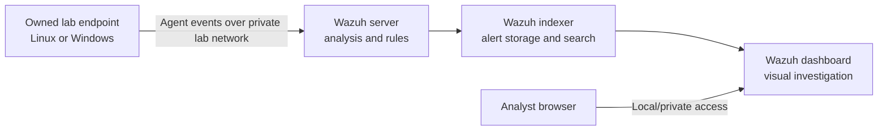

# Lab architecture

## Beginner layout
Use a single Wazuh all-in-one server VM for a small lab, plus one endpoint VM if your computer has enough resources. The all-in-one quickstart places Wazuh server, indexer, and dashboard on one host. Keep both VMs on a private host-only or isolated virtual network. NAT may be used temporarily for installation updates if needed; do not add public port forwarding, and return to isolation for exercises.

## Components
- **Wazuh agent:** Installed on a monitored endpoint. Collects configured endpoint/security events and sends them to the manager.
- **Wazuh server (manager):** Receives and decodes events, evaluates rules, and produces alerts.
- **Wazuh indexer:** Stores alert data for querying.
- **Wazuh dashboard:** Web interface for health, alerts, and rule testing.

## Data flow
1. An authentication event occurs on the endpoint.
2. The agent collects the configured log source and forwards the event.
3. The manager decodes the record into fields and evaluates rules.
4. Matching alerts are indexed and displayed in the dashboard.
5. An analyst checks the event details, surrounding activity, and endpoint context before deciding what it means.

## Network and access notes
Use ports and firewall rules listed for the exact release and architecture installed. Restrict dashboard and manager access to the host or private lab subnet, use unique credentials, and never publish credentials, certificates, IPs, or identifying screenshots. Do not expose management services to the internet.

## Scale
Start with one manager and one endpoint. Add another endpoint only after confirming connectivity and event ingestion. Hardware requirements depend on data volume and deployment layout; use the current Wazuh Quickstart table rather than treating a fixed VM size as universal.
